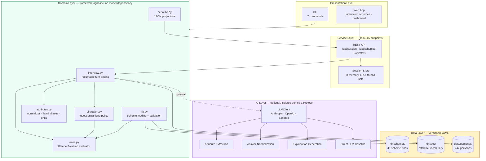
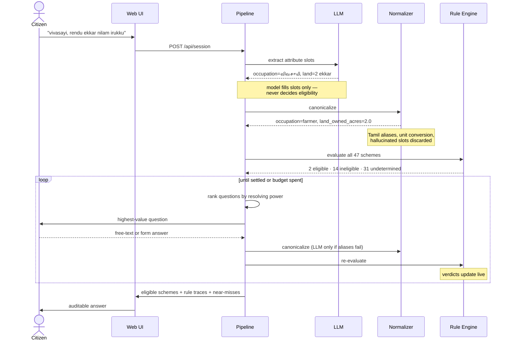
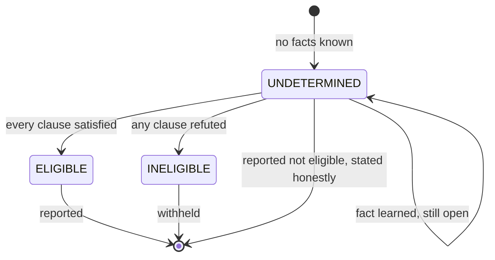
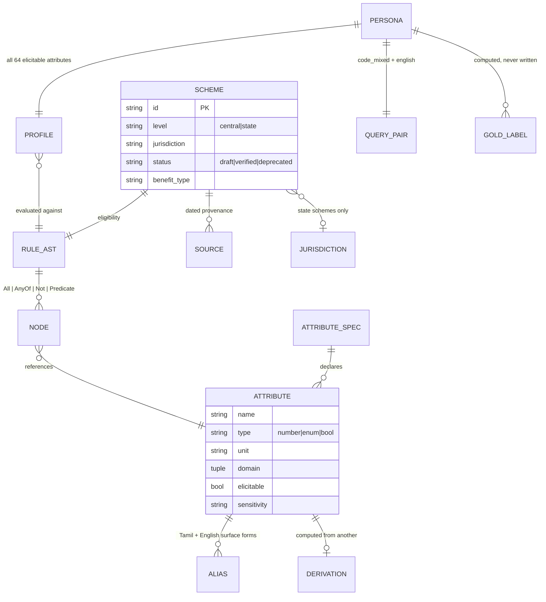

# TN-SchemeMatch

**Eligibility matching for Indian welfare schemes under code-mixed Tamil–English queries.**

A citizen types:

> *"enakku ration card irukku, vivasayi, rendu ekkar nilam — enna scheme kedaikum?"*
> ("I have a ration card, I'm a farmer with two acres — which schemes can I get?")

Knowing that PM-KISAN exists is easy. Deciding whether *this person* qualifies is not, and
getting it wrong has a cost: a citizen takes a day off work, travels to a district office,
and is turned away. This project builds the knowledge base, the benchmark, and a working
system to measure whether current AI gets it right — and whether it gets it *less* right
when the question is asked in code-mixed Tamil–English rather than clean English.

---

## At a glance

| | |
|---|---|
| **Schemes encoded** | 49 (47 active, 2 deliberately retained as discontinued) |
| **Jurisdictions** | Union Government (21) + Tamil Nadu (28) |
| **Attribute vocabulary** | 69 typed attributes (64 elicitable, 5 derived) |
| **Benchmark personas** | 247, each with paired code-mixed and English queries |
| **Tests** | 230, all passing, no API key required |
| **Interfaces** | Web application, REST API, CLI, Python library |
| **Code** | ~10,300 lines Python, ~1,350 lines frontend, 298 YAML data files |

```bash
pip install -e ".[dev,models]"
schemematch validate          # check KB and benchmark integrity
schemematch serve             # launch the web application
pytest -q                     # 230 tests, no network needed
```

---

## The core idea

**The language model never decides eligibility.**

It does exactly one job: read a messy, code-mixed sentence and say which structured
attribute slots it fills. Everything after that is deterministic — units and category
labels are canonicalised by a normalizer, missing facts are chosen by a transparent
policy, and the eligibility decision is a rule evaluation that prints its own reasoning.

That division is the project's contribution and its defence. A model that says
*"you qualify for PM-KISAN"* cannot be audited. A rule engine that says
*"eligible, because land_owned_acres 2.0 > 0.0 AND age 45 ≥ 18 AND not a taxpayer"*
can be checked by a caseworker, a lawyer, or the citizen.

---

## System architecture



**Why the AI layer is isolated.** The core package has no model dependency at all. The
entire test suite — all 230 tests — runs with no API key and no network. A language model
is an optional accelerant, not a load-bearing component, and the system degrades to a
fully-functional rules-only mode when it is unavailable.

---

## The pipeline: extract → normalize → elicit → evaluate



---

## Three-valued logic

Every scheme lands in one of three states. `UNDETERMINED` is a first-class answer, not a
failure — it is the signal that drives the interview.



A single `FALSE` clause settles a conjunction regardless of what else is unknown — so
"male" rules out a women-only scheme immediately, without knowing anything else about the
person. This is what makes an interview terminate in ~15 questions instead of 64.

---

## Functional requirements

| ID | Requirement | Verified by |
|---|---|---|
| **FR-1** | Accept a natural-language query in English, Tamil script, romanized Tamil, or any code-mixed combination | `test_attributes.py`, `test_interview.py` |
| **FR-2** | Extract structured attribute values from an unstructured query using an LLM | `test_interview.py::test_extraction_normalizes_code_mixed_values` |
| **FR-3** | Canonicalize surface forms to typed values — Tamil aliases, unit conversion (acres/cents/hectares, lakh/crore, monthly→annual) | `test_attributes.py` (14 tests) |
| **FR-4** | Discard extracted values outside the vocabulary rather than guessing | `test_systems.py::test_unparseable_extraction_is_dropped_not_guessed` |
| **FR-5** | Evaluate every scheme under three-valued logic and classify as eligible / ineligible / undetermined | `test_rules.py` (18 tests) |
| **FR-6** | Select the next question by expected resolving power, re-ranked after every answer | `test_interview.py`, `test_kb_and_personas.py` |
| **FR-7** | Accept both typed form input and free-text answers, falling back to the LLM only when deterministic parsing fails | `test_interview.py::test_parse_answer_prefers_aliases_over_the_model` |
| **FR-8** | Never re-ask a question the user declined | `test_interview.py::test_skipped_questions_are_not_reasked` |
| **FR-9** | Terminate when all schemes are settled or the question budget is exhausted | `test_interview.py::test_question_budget_is_enforced` |
| **FR-10** | Return eligible schemes with a full, per-clause rule trace showing observed values | `test_serialize.py` (14 tests) |
| **FR-11** | Report near-misses — schemes failed by exactly one condition | `test_serialize.py::test_near_misses_have_exactly_one_failing_condition` |
| **FR-12** | Report undetermined schemes as not eligible, and say so explicitly | `test_web_api.py` |
| **FR-13** | Generate a plain-language explanation, in English or Tamil, grounded strictly in the rule trace | `test_web_api.py::test_explain_is_grounded_only_in_satisfied_clauses` |
| **FR-14** | Run a naive direct-LLM baseline alongside the grounded pipeline for comparison | `test_web_api.py::test_compare_separates_false_positives_from_hallucinations` |
| **FR-15** | Operate fully without any LLM (rules-only mode) | `test_web_api.py::test_start_without_ai_makes_no_model_call` |
| **FR-16** | Validate KB and benchmark integrity on demand | `schemematch validate`, `test_kb_and_personas.py` |
| **FR-17** | Browse all schemes with filters, showing official prose beside the encoded rule | `test_web_api.py::test_schemes_endpoint_lists_every_active_scheme` |
| **FR-18** | Score system output against ground truth across 13 metrics | `test_metrics.py` (18 tests) |

---

## Non-functional requirements

| ID | Category | Requirement | Status |
|---|---|---|---|
| **NFR-1** | **Auditability** | Every eligibility verdict must be traceable to named clauses and observed values. No verdict may originate from a model. | Enforced by architecture — the LLM has no path to a verdict |
| **NFR-2** | **Correctness** | Ground truth is computed from rules, never hand-labelled, so labels are internally consistent by construction | `test_fully_specified_profile_settles_every_scheme` |
| **NFR-3** | **Provenance** | Every scheme cites a dated source that was actually retrieved | `docs/retrieval-log.md` + `test_sources_from_the_fetch_era_have_a_retrieval_record` |
| **NFR-4** | **Availability** | Full functionality without network or API key | 230/230 tests run offline |
| **NFR-5** | **Performance** | Question ranking < 5 ms; full interview < 100 ms excluding LLM latency | Measured: 3.8 ms rank, 50 ms interview |
| **NFR-6** | **Performance** | KB and vocabulary loaded once at startup, shared read-only across requests | Immutable dataclasses, frozen rule AST |
| **NFR-7** | **Scalability** | Adding schemes must not degrade elicitation super-linearly | Enum probe reduction: 458 → 247 evaluations, flat in jurisdiction count |
| **NFR-8** | **Maintainability** | Adding a scheme requires no code change | Pure YAML; loader globs recursively |
| **NFR-9** | **Testability** | Every AI path testable without a live model | `ScriptedClient` test double |
| **NFR-10** | **Data integrity** | Adding a scheme must not silently alter any existing ground-truth label | `scripts/gold_diff.py`, run at every batch |
| **NFR-11** | **Safety** | Undetermined must never be reported as eligible; false positives are reported separately from F1 | `false_positive_rate`, `harmful_recommendation_rate` |
| **NFR-12** | **Accessibility** | Theme-aware UI, keyboard-navigable, Tamil renders without network fonts | System font stack, native `<details>` disclosure |
| **NFR-13** | **Portability** | No build step, no CDN, no external runtime dependency for the frontend | Vanilla ES modules |
| **NFR-14** | **Honesty** | Unverified data must be labelled as such everywhere it surfaces | `status: draft` on all 47 active schemes, banner in UI |

---

## Design decisions

### 1. Ground truth is computed, never labelled

Annotators verify *rules* and *query wording*. They never write down eligible sets. Gold
labels are whatever the rule engine returns for a persona's full profile — so labels are
internally consistent by construction, and the whole benchmark regenerates when a rule is
corrected. A validation check enforces the precondition: no scheme may return
`UNDETERMINED` for a fully-specified profile, because that would mean its rule reads an
attribute personas cannot supply, and its label would be a silent guess.

### 2. The headline metric is not F1

`false_positive_rate` — the fraction of returned schemes the citizen does not qualify for
— is reported **separately** from F1. The two errors are not interchangeable. A false
negative means someone does not hear about a benefit; that is bad, and it is the status
quo. A false positive sends them to a district office for nothing. F1 averages those
together and hides exactly the thing that matters.

`harmful_recommendation_rate` isolates **discontinued** schemes. The KB deliberately
retains two — a Tamil Nadu marriage grant dead since 2022-23, and RSBY, subsumed into
PM-JAY in 2018-19. Both are still described in the present tense across most of the web,
so a retrieval corpus scraped today will surface them. Recommending one is the most costly
single error available, and the benchmark catches it.

### 3. Asking questions in batches costs accuracy

Every answer changes which question is most informative next, so a batch of three spends
questions a prior answer would have made unnecessary. On one persona that waste was enough
to drop a scheme she genuinely qualified for. `ask_batch_size` therefore defaults to 1 —
and this is recorded as a test, not a comment.

---

## Data model



**Attribute vocabulary:** 69 attributes — 38 boolean, 16 numeric, 15 categorical. 60 are
read by at least one rule. 5 are derived (computed, never asked).

**Rule complexity:** mean 6.7 nodes per scheme, maximum 18. Rules nest `all` / `any` /
`not` arbitrarily; PM-KISAN's has three exclusion clauses and a nested carve-out.

---

## Module breakdown

| Module | Lines | Responsibility |
|---|---:|---|
| `kb.py` | 557 | Scheme loading, validation, jurisdiction scoping, coverage reporting |
| `rules.py` | 442 | Rule AST, Kleene three-valued evaluator, traces, rule parser |
| `attributes.py` | 425 | Typed vocabulary, Tamil/English alias resolution, unit normalization |
| `interview.py` | 420 | Resumable turn-based interview engine (state in, state out) |
| `elicitation.py` | 413 | Pivotality, question ranking, oracle question sequences |
| `web/app.py` | 412 | Flask application factory, 16 REST endpoints |
| `serialize.py` | 391 | JSON projections — trace trees, scheme cards, form contracts |
| `personas.py` | 375 | Persona loading, computed ground truth, benchmark statistics |
| `eval/metrics.py` | 335 | Set metrics, false-positive rate, paired bootstrap |
| `systems/` | 984 | RAG baseline, direct baseline, grounding pipeline, model clients |

---

## Interfaces

**Web application** (`schemematch serve`) — three screens:
- **Interview** — query box, live extraction panel showing raw model output beside the
  normalized profile, one question at a time with the right control for its type, a live
  scoreboard, and a per-scheme cell grid that recolours as verdicts settle
- **Schemes browser** — all 47 active schemes, filterable, with official prose displayed
  beside the encoded rule tree
- **Dashboard** — KB coverage, attribute usage, benchmark statistics, experiment results

**REST API** — 16 endpoints under `/api`, including session lifecycle
(`POST /api/session`, `/answer`, `/skip`, `/finish`, `GET /result`), explanation
(`/explain/<scheme_id>?lang=en|ta`), and the baseline comparison (`POST /compare`).

**CLI** — `validate`, `stats`, `build`, `serve`, `explain`, `ask`, `verify-queue`.

---

## Testing and verification

```
162 test functions -> 230 cases (parametrised) — all offline, no API key
├── test_kb_and_personas.py   31  KB integrity, jurisdiction scoping, provenance
├── test_systems.py           24  RAG baseline, grounding pipeline, metrics wiring
├── test_web_api.py           23  every endpoint, error envelopes, full HTTP interview
├── test_interview.py         20  turn engine, answer parsing, budget, skip semantics
├── test_rules.py             18  Kleene operators, parser, traces
├── test_metrics.py           18  set metrics, paired bootstrap, harm isolation
├── test_attributes.py        14  Tamil aliases, unit conversion, canonicalization
└── test_serialize.py         14  JSON projections, trace trees, form contracts
```

Beyond the suite, three safeguards run at every change to the knowledge base:

- **`scripts/gold_diff.py`** enforces the invariant that adding scheme X must not change
  any persona's verdict on any scheme that is not X. Verified by deliberately perturbing a
  rule and confirming it fires.
- **`validate_kb`** proves every state scheme is refuted for a resident of every other
  state — a structural property of the rules, so it holds for states no persona lives in.
- **`docs/retrieval-log.md`** records every source fetch, including failures, so "cited"
  means a page that was actually read.

---

## What is not done yet

Stated plainly, because a benchmark that overstates its own standing is worse than a
small one.

**No scheme is human-verified.** All 47 active schemes carry dated sources, but
`status: draft` means no person has checked the encoded rule against the primary
Government Order. Run `schemematch verify-queue` for the list.

**The knowledge base is national; the benchmark is Tamil Nadu.** Every reported number
therefore measures matching over a national corpus for a Tamil Nadu population. That
residence-scoping is correct is verified *structurally*, not behaviourally. No claim is
made about performance for citizens of other states.

**Personas are not natively validated.** They were authored programmatically to exercise
the pipeline. A test enforces that unvalidated personas say so in their notes, so seed data
cannot quietly end up in a reported result.

**Six schemes are sourced but deliberately excluded**, listed in
`docs/unsourced-queue.md` with reasons — thin sources, missing vocabulary, or retrieval
failure. Roughly a third of official government portals could not be retrieved at all:
DNS failures, 403s, client-rendered pages, and broken TLS chains.

**Known modelling limitations** are recorded in the scheme files rather than left silent —
family-scoped conditions approximated by applicant-level tests, block-level geography that
the vocabulary cannot express, and a "greenfield enterprise" condition with no attribute
behind it.

---

## Research framing

Three questions, of which the second is the spine:

- **RQ1** — Can current agents do *matching*, not just retrieval, when rules involve
  numeric thresholds and category constraints?
- **RQ2 (primary)** — Does eligibility-matching accuracy degrade under code-mixing versus
  clean English, holding the persona and the rules fixed? If robustness degrades for the
  population that most needs these schemes, that is a finding with direct equity stakes.
- **RQ3** — Does a structured eligibility-grounding layer beat plain RAG over scheme text?

RQ2 is measured with a **paired bootstrap** over shared personas. Pairing is what makes
the comparison clean: the two conditions describe the same person against the same rules,
so persona difficulty cancels.

**An honest confound, stated up front.** BM25 is not language-neutral — a code-mixed query
carries fewer English content words, so lexical retrieval degrades for reasons that have
nothing to do with reasoning. The harness therefore reports `retrieval_recall` and
`matching_recall` side by side, and ships an `OracleRetriever` that removes retrieval error
entirely. Whatever gap survives is reasoning.

---

## Technology

Python 3.11 · Flask · PyYAML · jsonschema · pytest · Anthropic and OpenAI SDKs (optional) ·
vanilla ES modules with no build step

## License

Code: MIT. Data and KB: CC-BY-4.0. Scheme text is reproduced from Government of India and
Government of Tamil Nadu sources, cited and dated per scheme.
