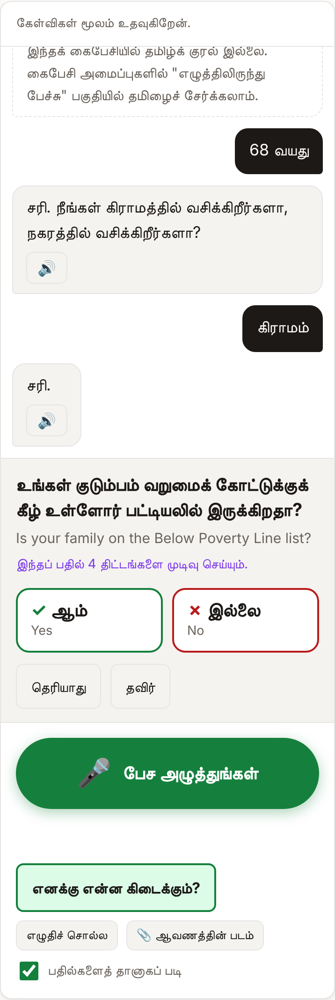
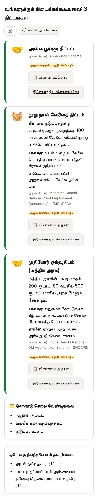
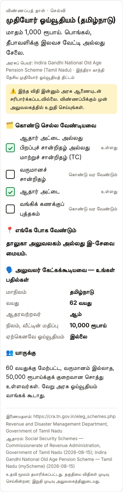
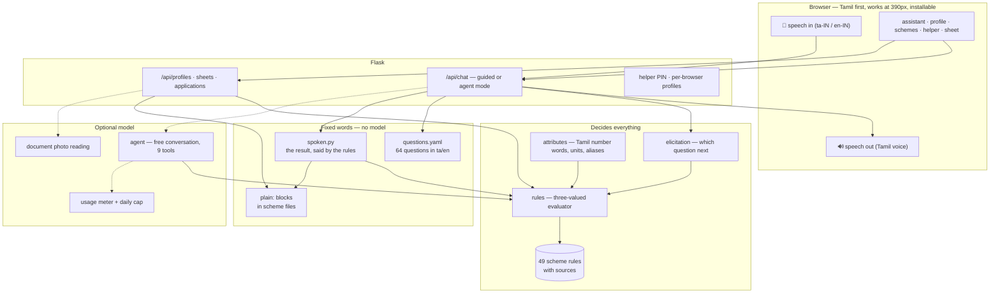

# உதவி · Udhavi

**A voice-first assistant that tells a Tamil Nadu family which government schemes they can
get, what papers to bring, and where to go — in Tamil, by speaking or tapping.**

A widow in a village near Madurai cannot read the form, and "Indira Gandhi National Widow
Pension Scheme" means nothing to her. She taps the microphone and answers a few questions
in Tamil. The app tells her, out loud: *"உங்களுக்கு மூன்று திட்டங்கள் கிடைக்க வாய்ப்பு
உள்ளது… கொண்டு செல்ல வேண்டியவை: ஆதார் அட்டை, வங்கிக் கணக்குப் புத்தகம்…"* — and
prints a one-page sheet she can carry to the taluk office.

Getting this wrong has a cost: a family loses a day's wages travelling to an office and is
turned away. So the app is built around one rule.

> **A rule engine decides who is eligible. The language model never does.**
> Every verdict a person sees or hears comes from `rules.py`, evaluated against rules
> encoded from published government sources — not from model text.

| | |
|---|---|
| **Schemes** | 54 encoded (52 active): 21 central, 28 Tamil Nadu, 5 Kerala |
| **Plain Tamil and English** | 20 most-used schemes, in words a person would say |
| **Questions** | All 64 askable facts worded in spoken Tamil and plain English |
| **Works without AI** | Yes — the whole conversation runs with no API key and no credit |
| **Voice** | Speak in (Tamil or English), every reply read aloud |
| **Malayalam** | Typed or spoken answers in Malayalam and Manglish understood; Kerala pensions |
| **Tests** | ~370 offline tests + 8 browser tests (phone width, accessibility), in CI on every push |

<p align="center">
  
  
  
</p>

---

## Try it

```bash
pip install -e ".[dev]"
python scripts/serve.py --backend none        # no AI at all: guided mode
# open http://127.0.0.1:5001
```

That is the whole product working: questions in Tamil, answers by button, number or voice,
the result read aloud, application sheets, the helper's list. No key, no network, no cost.

To let people **talk freely** instead of answering one question at a time, add a model:

```bash
pip install -e ".[dev,models]"
export ANTHROPIC_API_KEY='...'
python scripts/serve.py --model claude-haiku-5-5 --daily-budget 0.50
```

When the key is missing, the credit runs out or the day's budget is spent, the assistant
**carries on in guided mode** in the middle of the conversation, with one line saying so.

To serve more than one family from one machine, set a helper PIN:

```bash
export HELPER_PIN='2468'          # helpers log in at /helper
export SECRET_KEY='any long random string'   # keeps logins across restarts
```

---

## Who it is for, and what they do

**A citizen** (often with low literacy, often Tamil-only) opens the app on a phone:

1. **Speak or tap.** The big green button listens in Tamil (`ta-IN`) or English. Or tap the
   answer buttons — every option is in Tamil with English underneath.
2. **One question at a time**, chosen so each answer settles as many schemes as possible
   ("இந்தப் பதில் 30 திட்டங்களை முடிவு செய்யும்"). "தெரியாது" is always an answer;
   sensitive questions (caste, health, income) say they can be skipped.
3. **Hear the result.** Schemes in plain words — *"மாதம் 1,000 ரூபாய்…"* — with who it is
   for, where to go, the papers to bring, schemes missed by one condition, and what opens
   up later (*"3 வருடத்தில், 60 வயதில்: முதியோர் ஓய்வூதியம்"*).
4. **Take the sheet.** One printable A4 page per scheme: the checklist with ✓ marks, the
   office, and *what the officer may ask* — the facts the rule checked, with their answers.
   Read it aloud, print it, or send it on WhatsApp.

**A helper** — an e-Sevai operator, anganwadi or ASHA worker, panchayat volunteer, NSS
student — logs in at `/helper` and sees every family, most actionable first: applications
that have gone quiet for 30 days, papers still missing for a scheme someone can get, people
one condition away, people who turn 60 next year. They record each application (applied,
reference number, sanctioned, rejected) and start the assistant for any person.

**Beyond the sheet.** Each scheme shows what it pays (every figure checked against its
sourced text) and which schemes cannot be taken together. The sheet says where to get each
missing paper. A rejection is recorded with its reason and explained against the rule, a
complaint letter can be drafted in Tamil, Malayalam or English, and `/admin` counts the
rejections the rules disagree with — the loop that finds a wrong rule. The profile page
shows the family's total, actions that would unlock a scheme, and what opens or closes
with age. Helpers can run a **camp** (`/camp`) and give a panchayat an **anonymous
report** (`/reports`, counts under 5 hidden). Other organisations' apps can ask the rule
engine through a keyed, stateless **partner API**. Every person has a consent record, a
download of their data, and a log of who opened their profile.

---

## How it stays safe

| Risk | What the product does |
|---|---|
| The model invents an eligibility | It cannot reach a verdict except through the `check_eligibility` tool, which is the rule engine. Every scheme a reply names gets the engine's own verdict as a chip beside it, and whenever the model checks eligibility the engine's own result is read aloud after its reply — so an overstatement is contradicted in the person's language. |
| A rule is wrong | Every rule cites dated sources. Schemes not yet checked by a person against the Government Order are said as *"you may be able to — confirm at the office"*, never *"you can apply"*. 247 test profiles act as regression tests: `scripts/gold_diff.py` shows whose result a rule change moves. |
| A sheet sends someone to the wrong office | A sheet is made only for a scheme the rules say the person is eligible for. `where` names a kind of office, never an address. |
| Private data leaks | Saved profiles stay in a SQLite file on the machine running the server. Document photos are deleted once read (only what was read is kept), unless kept on purpose. With a PIN, a citizen's browser sees only the profiles it created. |
| Speech goes to a third party | Chrome sends microphone audio to Google to recognise it. The page says so, out loud, before the first recording and offers typing instead. |
| The money runs out | Every model call is priced and logged; a daily cap stops spending before the credit does; guided mode needs no model at all. |

---

## What the model costs

The project runs on a small prepaid credit. Rough cost of one 8-message conversation,
estimated from the size of the tool list (~3–4K tokens resent each step) with prompt caching:

| Model | Price per 1M tokens (in / out) | One conversation | Conversations per $5 |
|---|---|---|---|
| `claude-opus-5-5` (default) | $4 / $20 | ~$0.30–0.50 | ~10–15 |
| `claude-sonnet-5-5` | $2 / $10 | ~$0.15–0.25 | ~20–30 |
| `claude-haiku-5-5` | $0.10 / $0.50 | ~$0.01 | ~400+ |

Guided mode costs nothing. Today's spend shows when the server starts and on `/admin`
(estimated from list prices; the Anthropic console is the record of what was charged).

---

## How it works



- **Guided mode** (`guided.py`): the elicitation policy picks the question; `questions.yaml`
  says it; the answer is read deterministically — including spoken Tamil numbers
  (*"rendu ekkar"*, *"அறுபத்தைந்து"*, *"ஐந்தாயிரம்"*) and a two-month electricity bill.
- **Agent mode** (`agent.py`): a model with nine tools holds a free conversation in Tamil,
  Tanglish or English. Its tools are the same rule engine, elicitation policy, vault and
  checklist; it chooses words, never verdicts.
- **Rules** (`rules.py`, `kb/schemes/`): three-valued logic, so a missing fact leaves a
  scheme *undetermined* rather than silently *not eligible*. See
  [`docs/rule-language.md`](docs/rule-language.md).
- **Sheets and forecasts** (`pack.py`): the officer's questions are the clauses that decided
  the rule; "coming up" re-runs the rules with the person one to five years older.
- **Helper list** (`caseload.py`): who needs what, most actionable first.

---

## Project layout

```
kb/schemes/{central,tn,kl}/*.yaml  scheme rules, sources, plain words, amounts, overlaps
kb/spec/attributes.yaml          the 69 facts a rule can read
kb/spec/questions.yaml           how each is asked, in Tamil and English
kb/spec/documents.yaml           29 document types and what each can prove
kb/spec/document_guides.yaml     how to get each one, per state
kb/spec/rejections.yaml          why applications are rejected, and what to do
data/personas/                   249 test profiles (regression tests for the rules)
src/tn_schemematch/
  rules.py  kb.py  attributes.py  elicitation.py  interview.py     the rule engine
  guided.py  spoken.py  pack.py  caseload.py                       the product
  benefits.py  outlook.py  applications.py                         money, family, rejections
  helpers.py  partners.py  privacy.py  watch.py                    camps, partner API, consent
  agent.py  agent_tools.py  documents.py  vault.py                 assistant, photos, storage
  systems/clients.py  systems/budget.py                            model client, usage meter
  web/                                                             Flask app and pages
scripts/serve.py  scripts/demo.py  scripts/gold_diff.py
docs/                            plan, verification protocol, field test, rule language
```

```bash
schemematch validate      # every rule, question, document mapping and test profile
python -m pytest -q       # offline; no key, no network
```

---

## What is not done yet

Stated plainly, because a "yes" this app says can send a family to an office:

- **No rule is human-verified yet.** All 47 active rules are drafts encoded from published
  sources, and the app says so. Verifying the 15 most common against their Government
  Orders ([`docs/verification-protocol.md`](docs/verification-protocol.md)) is the most
  important next step.
- **The Tamil has not been reviewed by a native speaker.** The questions, option labels and
  plain scheme text are marked `reviewed: false` until someone reads every line aloud.
- **No field test yet.** [`docs/field-test.md`](docs/field-test.md) is the plan: five
  tasks with 5–10 people, recorded honestly.
- **Voice depends on the device.** Speech recognition needs Chrome; reading Tamil aloud
  needs a Tamil voice on the phone (the page says how to add one).
- **Missing schemes rural families need:** PMAY-Gramin, NSAP's family benefit, the
  construction and unorganised workers' welfare boards, e-Shram, Kisan Credit Card.
- **Unreviewed guidance.** How to get each paper, rejection reasons and grievance contacts
  are written from general knowledge and marked `reviewed: false`; the pages say so.
- **Kerala is a start.** Five welfare pensions, from local bodies' pages (the state pension
  portal refused the connection); house size, vehicle and years of residence are not
  checked; the page is not yet in Malayalam.

This is not a government service. Always confirm at an e-Sevai centre or the department
office before applying.

## Roadmap

1. Verify the 15 most common rules; get the Tamil reviewed.
2. Field test with real families and an e-Sevai centre; fix the top three problems.
3. Add the missing rural schemes, with sources.
4. Later: a WhatsApp bot that takes voice notes, a phone line for people without
   smartphones, SMS reminders for missing papers and deadlines, more languages.

The full plan is in [`docs/product-plan.md`](docs/product-plan.md). The earlier research
version of this project (a benchmark of AI eligibility matching under code-mixed queries)
is preserved at commit `b0e49cc` on `master`, with its proposal in
[`docs/archive/`](docs/archive/).

## License

CC-BY-4.0.
