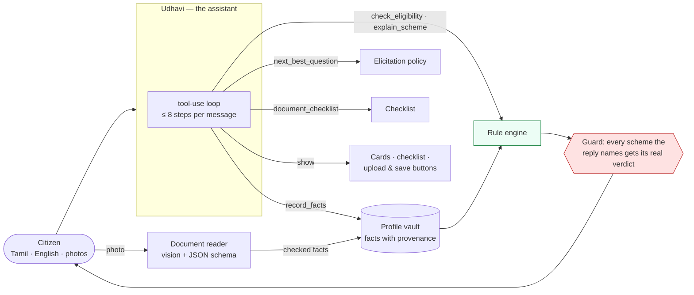
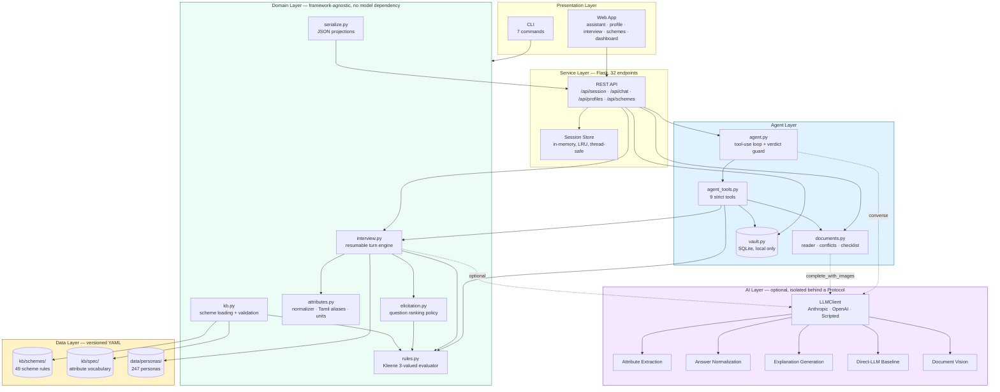
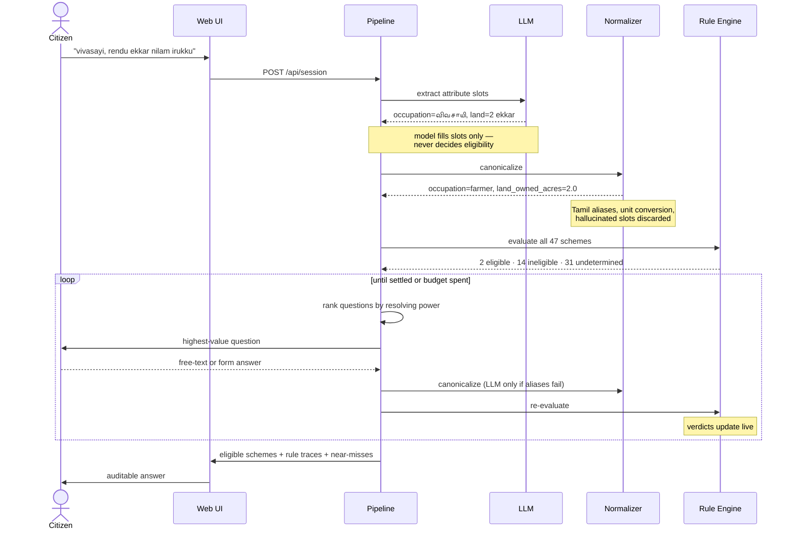
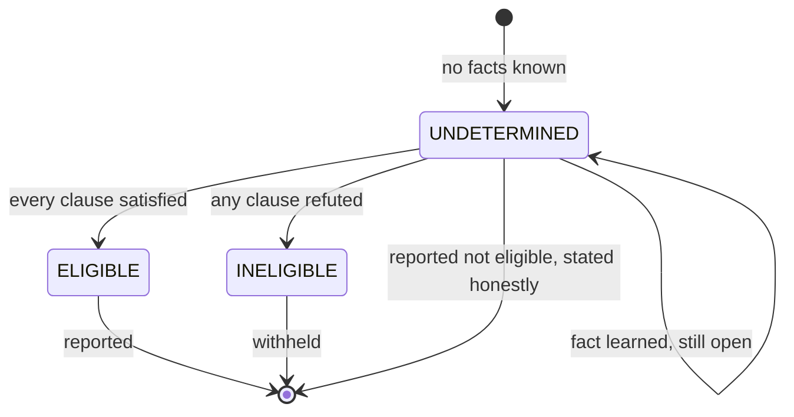
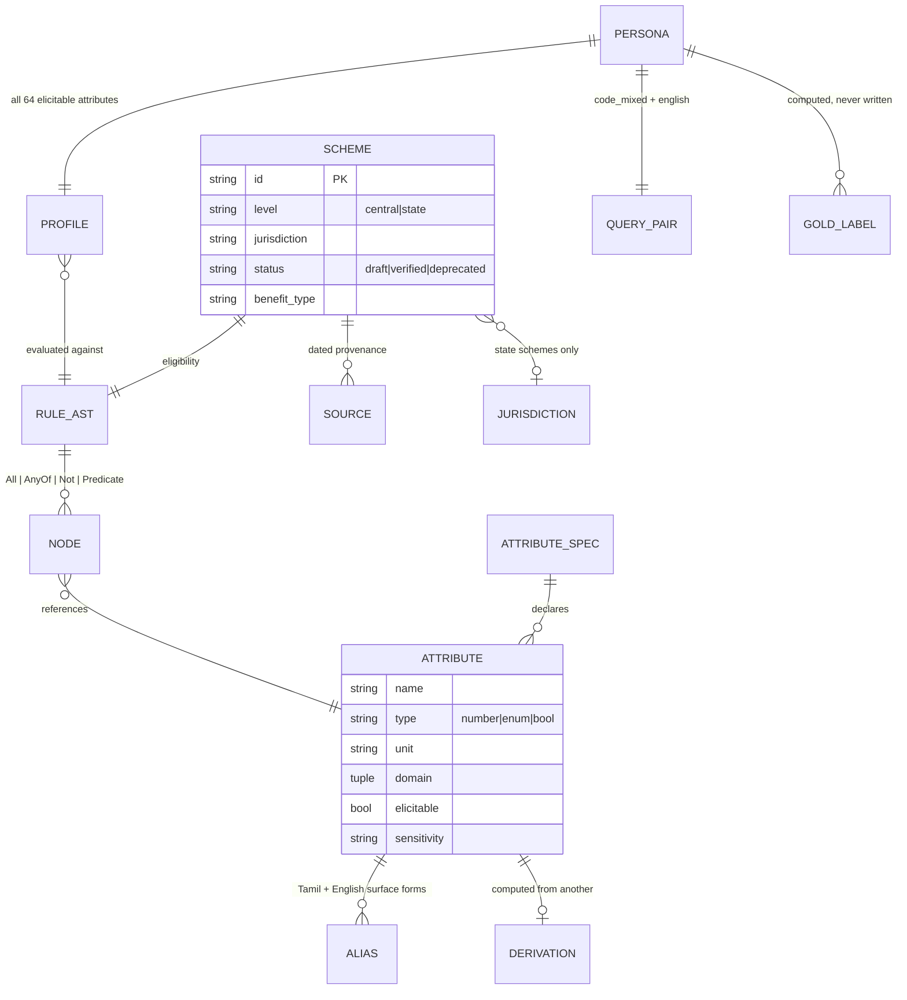

# TN-SchemeMatch

**Eligibility matching for Indian welfare schemes under code-mixed Tamil–English queries —
and an assistant that takes a citizen from "which schemes?" to "ready to apply".**

A citizen types:

> *"enakku ration card irukku, vivasayi, rendu ekkar nilam — enna scheme kedaikum?"*
> ("I have a ration card, I'm a farmer with two acres — which schemes can I get?")

Knowing that PM-KISAN exists is easy. Deciding whether *this person* qualifies is not, and
getting it wrong has a cost: a citizen takes a day off work, travels to a district office,
and is turned away. This project builds the knowledge base, the benchmark, and a working
system to measure whether current AI gets it right — and whether it gets it *less* right
when the question is asked in code-mixed Tamil–English rather than clean English.

On top of that sits **Udhavi (உதவி)**, an AI assistant that carries the citizen the rest of
the way: it holds the interview as a conversation, remembers what they said, reads photos
of their certificates, and tells them which papers to collect for which scheme. It is
built so that the model never decides who is eligible — see [the agent layer](#the-agent-layer).

---

## At a glance

| | |
|---|---|
| **Schemes encoded** | 49 (47 active, 2 deliberately retained as discontinued) |
| **Jurisdictions** | Union Government (21) + Tamil Nadu (28) |
| **Attribute vocabulary** | 69 typed attributes (64 elicitable, 5 derived) |
| **Document vocabulary** | 28 document types; all 75 document requirements in the KB mapped |
| **Assistant** | 9 tools over the rule engine, elicitation policy, profile vault and checklist |
| **Benchmark personas** | 247, each with paired code-mixed and English queries |
| **Tests** | 303, all passing, no API key required |
| **Interfaces** | Assistant, profile page, interview, REST API (32 endpoints), CLI, Python library |
| **Code** | ~13,600 lines Python, ~2,600 lines frontend, 299 YAML data files |

```bash
pip install -e ".[dev,models,web]"
schemematch validate          # check KB, document mapping and benchmark integrity
schemematch serve             # launch the web application (claude-opus-5-5 by default)
pytest -q                     # 303 tests, no network needed
```

---

## The core idea

**The language model never decides eligibility.**

It does exactly one job: read a messy, code-mixed sentence and say which structured
attribute slots it fills. Everything after that is deterministic — units and category
labels are canonicalised by a normalizer, missing facts are chosen by a transparent
policy, and the eligibility decision is a rule evaluation that prints its own reasoning.

That division is the project's contribution and its defence. A model that says
*"you qualify for PM-KISAN"* cannot be audited. A rule engine that says
*"eligible, because land_owned_acres 2.0 > 0.0 AND age 45 ≥ 18 AND not a taxpayer"*
can be checked by a caseworker, a lawyer, or the citizen.

---

## The agent layer

The matcher answers *"which schemes?"*. A citizen still has to get from there to a filled
application, and that is where most people give up. Three parts close the gap — each one
an AI feature, and each one built so that the rule engine stays the only thing that
decides eligibility.



**1. Profile vault — answer once, reuse everywhere** (`vault.py`). Saved people, grouped into
households, with every fact stored as an append-only log: *what* was said, *how* it was
learned (said in chat, picked on a form, read off a certificate), *when*, and the citizen's
own words as evidence. The interview, the assistant and the profile page all start from
it, so nothing on file is asked again. Eligibility is remembered as a set, so a life event
— a birthday, a new job, a marriage — is reported as what it changed: *"+ now eligible for
the old-age pension, − no longer eligible for PMJJBY"*.

**2. Document reader — arrange my documents** (`documents.py`, `kb/spec/documents.yaml`).
Upload a photo; a vision model identifies the document and reads the facts it states. The
reply is constrained by a JSON schema whose attribute field is an *enum of the vocabulary*,
so the model cannot even express an attribute that does not exist. Every fact is then
re-checked deterministically: kept only if that *kind* of document can prove it (a ration
card cannot prove caste), canonicalized by the same normalizer as typed answers, with ID
numbers masked to their last four digits. A reading never overwrites what the citizen said
— a disagreement comes back as a conflict to settle. The checklist then ranks what to
collect by how many of the person's schemes need it (*"Income certificate — needed for 3
schemes"*). With no model, the citizen names the document type and the checklist still works.

**3. The assistant — navigate the site** (`agent.py`, `agent_tools.py`). A native tool-use
loop over nine tools, each wrapping code the project already trusts:

| Tool | What it does | Built on |
|---|---|---|
| `get_profile` | what is already known, and from where | vault |
| `record_facts` | save what the person said, with their words as evidence | the normalizer |
| `next_best_question` | the single most useful question — the engine picks it, the model phrases it | elicitation policy |
| `skip_question` | never ask a declined question again | interview state |
| `check_eligibility` | verdicts, near misses, and what changed since the last check | rule engine |
| `explain_scheme` | only the clauses that decided the verdict, plus documents and where to apply | trace |
| `search_schemes` | browse by topic, with this person's verdict on each | catalogue |
| `document_checklist` | papers per scheme, what is on file, what to collect | checklist |
| `show` | put a scheme card, the checklist, an upload or save button, or a link on screen | — |

Schemas are `strict`, and attribute and scheme ids are enums. The model's job is the
conversation — understanding a messy reply in Tamil or English, asking kindly, choosing the
next tool. **After every reply, a guard finds each scheme the text names and attaches the
rule engine's real verdict as a chip beside it**, so "you can get the women's scheme" next
to a red *not eligible* is a visible contradiction rather than a silent one. The page also
shows every step the agent took.

---

## System architecture



**Why the AI layer is isolated.** The core package has no model dependency at all. The
entire test suite — all 230 tests — runs with no API key and no network. A language model
is an optional accelerant, not a load-bearing component, and the system degrades to a
fully-functional rules-only mode when it is unavailable.

---

## The pipeline: extract → normalize → elicit → evaluate



---

## Three-valued logic

Every scheme lands in one of three states. `UNDETERMINED` is a first-class answer, not a
failure — it is the signal that drives the interview.



A single `FALSE` clause settles a conjunction regardless of what else is unknown — so
"male" rules out a women-only scheme immediately, without knowing anything else about the
person. This is what makes an interview terminate in ~15 questions instead of 64.

---

## Functional requirements

| ID | Requirement | Verified by |
|---|---|---|
| **FR-1** | Accept a natural-language query in English, Tamil script, romanized Tamil, or any code-mixed combination | `test_attributes.py`, `test_interview.py` |
| **FR-2** | Extract structured attribute values from an unstructured query using an LLM | `test_interview.py::test_extraction_normalizes_code_mixed_values` |
| **FR-3** | Canonicalize surface forms to typed values — Tamil aliases, unit conversion (acres/cents/hectares, lakh/crore, monthly→annual) | `test_attributes.py` (14 tests) |
| **FR-4** | Discard extracted values outside the vocabulary rather than guessing | `test_systems.py::test_unparseable_extraction_is_dropped_not_guessed` |
| **FR-5** | Evaluate every scheme under three-valued logic and classify as eligible / ineligible / undetermined | `test_rules.py` (18 tests) |
| **FR-6** | Select the next question by expected resolving power, re-ranked after every answer | `test_interview.py`, `test_kb_and_personas.py` |
| **FR-7** | Accept both typed form input and free-text answers, falling back to the LLM only when deterministic parsing fails | `test_interview.py::test_parse_answer_prefers_aliases_over_the_model` |
| **FR-8** | Never re-ask a question the user declined | `test_interview.py::test_skipped_questions_are_not_reasked` |
| **FR-9** | Terminate when all schemes are settled or the question budget is exhausted | `test_interview.py::test_question_budget_is_enforced` |
| **FR-10** | Return eligible schemes with a full, per-clause rule trace showing observed values | `test_serialize.py` (14 tests) |
| **FR-11** | Report near-misses — schemes failed by exactly one condition | `test_serialize.py::test_near_misses_have_exactly_one_failing_condition` |
| **FR-12** | Report undetermined schemes as not eligible, and say so explicitly | `test_web_api.py` |
| **FR-13** | Generate a plain-language explanation, in English or Tamil, grounded strictly in the rule trace | `test_web_api.py::test_explain_is_grounded_only_in_satisfied_clauses` |
| **FR-14** | Run a naive direct-LLM baseline alongside the grounded pipeline for comparison | `test_web_api.py::test_compare_separates_false_positives_from_hallucinations` |
| **FR-15** | Operate fully without any LLM (rules-only mode) | `test_web_api.py::test_start_without_ai_makes_no_model_call` |
| **FR-16** | Validate KB and benchmark integrity on demand | `schemematch validate`, `test_kb_and_personas.py` |
| **FR-17** | Browse all schemes with filters, showing official prose beside the encoded rule | `test_web_api.py::test_schemes_endpoint_lists_every_active_scheme` |
| **FR-18** | Score system output against ground truth across 13 metrics | `test_metrics.py` (18 tests) |
| **FR-19** | Save a person's facts with provenance (source, evidence, time) and reuse them in every later session | `test_vault.py` (17 tests) |
| **FR-20** | Report what a changed fact did to eligibility (schemes gained and lost) | `test_vault.py::test_a_life_event_reports_what_was_lost_and_regained` |
| **FR-21** | Read a photographed document, keeping only facts that document type can prove | `test_documents.py::test_reader_keeps_only_what_the_document_type_can_state` |
| **FR-22** | Never let a document overwrite a stated fact; surface disagreements as conflicts | `test_documents.py::test_a_document_never_silently_overwrites` |
| **FR-23** | Rank the documents to collect by how many eligible schemes need each | `test_documents.py::test_checklist_ranks_what_to_collect` |
| **FR-24** | Hold the interview as a tool-using conversation in Tamil or English | `test_agent.py` (16 tests) |
| **FR-25** | Attach the rule engine's verdict to every scheme the assistant names | `test_agent.py::test_the_guard_flags_a_scheme_the_rules_rule_out` |
| **FR-26** | Keep every raw model response with a run so it can be re-scored without the model | `test_clients.py::test_responses_round_trip_through_jsonl` |

---

## Non-functional requirements

| ID | Category | Requirement | Status |
|---|---|---|---|
| **NFR-1** | **Auditability** | Every eligibility verdict must be traceable to named clauses and observed values. No verdict may originate from a model. | Enforced by architecture — the LLM has no path to a verdict |
| **NFR-2** | **Correctness** | Ground truth is computed from rules, never hand-labelled, so labels are internally consistent by construction | `test_fully_specified_profile_settles_every_scheme` |
| **NFR-3** | **Provenance** | Every scheme cites a dated source that was actually retrieved | `docs/retrieval-log.md` + `test_sources_from_the_fetch_era_have_a_retrieval_record` |
| **NFR-4** | **Availability** | Full functionality without network or API key | 230/230 tests run offline |
| **NFR-5** | **Performance** | Question ranking < 5 ms; full interview < 100 ms excluding LLM latency | Measured: 3.8 ms rank, 50 ms interview |
| **NFR-6** | **Performance** | KB and vocabulary loaded once at startup, shared read-only across requests | Immutable dataclasses, frozen rule AST |
| **NFR-7** | **Scalability** | Adding schemes must not degrade elicitation super-linearly | Enum probe reduction: 458 → 247 evaluations, flat in jurisdiction count |
| **NFR-8** | **Maintainability** | Adding a scheme requires no code change | Pure YAML; loader globs recursively |
| **NFR-9** | **Testability** | Every AI path testable without a live model | `ScriptedClient` test double |
| **NFR-10** | **Data integrity** | Adding a scheme must not silently alter any existing ground-truth label | `scripts/gold_diff.py`, run at every batch |
| **NFR-11** | **Safety** | Undetermined must never be reported as eligible; false positives are reported separately from F1 | `false_positive_rate`, `harmful_recommendation_rate` |
| **NFR-12** | **Accessibility** | Theme-aware UI, keyboard-navigable, Tamil renders without network fonts | System font stack, native `<details>` disclosure |
| **NFR-13** | **Portability** | No build step, no CDN, no external runtime dependency for the frontend | Vanilla ES modules |
| **NFR-14** | **Honesty** | Unverified data must be labelled as such everywhere it surfaces | `status: draft` on all 47 active schemes, banner in UI |
| **NFR-15** | **Privacy** | Personal data stays on the machine running the app; ID numbers are masked before storage; one action deletes a person and their files | SQLite under git-ignored `data/vault/`, `mask_ids`, `test_delete_removes_facts_and_files` |
| **NFR-16** | **Agent safety** | The assistant reaches a verdict only through the rule engine, and every scheme it names is checked against it | Tool design + `scheme_mentions` guard |
| **NFR-17** | **Schema-bounded AI** | Model output that names an attribute, scheme or document type must be constrained to the vocabulary | Enum fields in the vision and tool schemas, `test_the_schema_limits_the_model_to_the_vocabulary` |
| **NFR-18** | **Reproducibility** | With sampling parameters removed from the API, a run is reproducible from its saved responses | `responses.jsonl` + `run_experiment.py --replay` |

---

## Design decisions

### 1. Ground truth is computed, never labelled

Annotators verify *rules* and *query wording*. They never write down eligible sets. Gold
labels are whatever the rule engine returns for a persona's full profile — so labels are
internally consistent by construction, and the whole benchmark regenerates when a rule is
corrected. A validation check enforces the precondition: no scheme may return
`UNDETERMINED` for a fully-specified profile, because that would mean its rule reads an
attribute personas cannot supply, and its label would be a silent guess.

### 2. The headline metric is not F1

`false_positive_rate` — the fraction of returned schemes the citizen does not qualify for
— is reported **separately** from F1. The two errors are not interchangeable. A false
negative means someone does not hear about a benefit; that is bad, and it is the status
quo. A false positive sends them to a district office for nothing. F1 averages those
together and hides exactly the thing that matters.

`harmful_recommendation_rate` isolates **discontinued** schemes. The KB deliberately
retains two — a Tamil Nadu marriage grant dead since 2022-23, and RSBY, subsumed into
PM-JAY in 2018-19. Both are still described in the present tense across most of the web,
so a retrieval corpus scraped today will surface them. Recommending one is the most costly
single error available, and the benchmark catches it.

### 3. Asking questions in batches costs accuracy

Every answer changes which question is most informative next, so a batch of three spends
questions a prior answer would have made unnecessary. On one persona that waste was enough
to drop a scheme she genuinely qualified for. `ask_batch_size` therefore defaults to 1 —
and this is recorded as a test, not a comment.

---

## Data model



**Attribute vocabulary:** 69 attributes — 38 boolean, 16 numeric, 15 categorical. 60 are
read by at least one rule. 5 are derived (computed, never asked).

**Rule complexity:** mean 6.7 nodes per scheme, maximum 18. Rules nest `all` / `any` /
`not` arbitrarily; PM-KISAN's has three exclusion clauses and a nested carve-out.

---

## Module breakdown

| Module | Lines | Responsibility |
|---|---:|---|
| `kb.py` | 557 | Scheme loading, validation, jurisdiction scoping, coverage reporting |
| `rules.py` | 442 | Rule AST, Kleene three-valued evaluator, traces, rule parser |
| `attributes.py` | 425 | Typed vocabulary, Tamil/English alias resolution, unit normalization |
| `interview.py` | 420 | Resumable turn-based interview engine (state in, state out) |
| `elicitation.py` | 413 | Pivotality, question ranking, oracle question sequences |
| `web/app.py` | 480 | Flask application factory, pages, session and catalogue routes |
| `documents.py` | 452 | Document vocabulary, vision reader, masking, conflicts, checklist |
| `vault.py` | 393 | Saved profiles: households, provenance log, documents, eligibility diffs |
| `agent_tools.py` | 362 | The assistant's nine strict tools |
| `web/profiles_api.py` | 314 | Profile, fact, document and checklist routes |
| `agent.py` | 175 | Tool-use loop, system prompt, verdict guard |
| `web/chat_api.py` | 125 | Assistant routes |
| `serialize.py` | 391 | JSON projections — trace trees, scheme cards, form contracts |
| `personas.py` | 375 | Persona loading, computed ground truth, benchmark statistics |
| `eval/metrics.py` | 335 | Set metrics, false-positive rate, paired bootstrap |
| `systems/` | 1,448 | RAG baseline, direct baseline, grounding pipeline, model clients |

---

## Interfaces

**Web application** (`schemematch serve`) — five screens:
- **Assistant** (`/`) — chat with Udhavi in Tamil or English; each reply shows the agent's
  steps, the rule engine's verdict on every scheme it named, and any cards, checklists or
  upload buttons it put on screen
- **My profile** (`/profile`) — saved people and households, their schemes, uploaded
  documents with what was read from each, conflicts to settle, the ranked checklist, and
  every fact with its source; editing a fact shows what it changed
- **Interview** (`/interview`) — query box, live extraction panel showing raw model output beside the
  normalized profile, one question at a time with the right control for its type, a live
  scoreboard, and a per-scheme cell grid that recolours as verdicts settle
- **Schemes browser** — all 47 active schemes, filterable, with official prose displayed
  beside the encoded rule tree
- **Dashboard** — KB coverage, attribute usage, benchmark statistics, experiment results

**REST API** — 32 endpoints under `/api`, including session lifecycle
(`POST /api/session`, `/answer`, `/skip`, `/finish`, `/save`, `GET /result`), explanation
(`/explain/<scheme_id>?lang=en|ta`), the baseline comparison (`POST /compare`), the assistant
(`POST /api/chat`, `/api/chat/<id>/message`), and profiles, facts, documents and checklists
under `/api/profiles`.

**CLI** — `validate`, `stats`, `build`, `serve`, `explain`, `ask`, `verify-queue`.

---

## Testing and verification

```
235 test functions -> 303 cases (parametrised) — all offline, no API key
├── test_kb_and_personas.py   35  KB integrity, jurisdiction scoping, provenance, staleness
├── test_web_api.py           25  every endpoint, error envelopes, full HTTP interview
├── test_systems.py           24  RAG baseline, grounding pipeline, metrics wiring
├── test_documents.py         23  reader guard rails, masking, conflicts, checklist, uploads
├── test_interview.py         20  turn engine, answer parsing, budget, skip semantics
├── test_rules.py             18  Kleene operators, parser, traces
├── test_metrics.py           18  set metrics, paired bootstrap, harm isolation
├── test_vault.py             17  provenance, invariants, life events, profile-seeded sessions
├── test_agent.py             16  tool loop, step cap, verdict guard, chat over HTTP
├── test_attributes.py        14  Tamil aliases, unit conversion, canonicalization
├── test_serialize.py         14  JSON projections, trace trees, form contracts
└── test_clients.py           11  exact API request shape: no sampling params, vision, tools
```

The model-backed paths are tested against a `ScriptedClient` that replays fixed responses
— including scripted multi-step tool calls — so the tests check what the code does with a
model's answer, never what a model happens to say.

Beyond the suite, three safeguards run at every change to the knowledge base:

- **`scripts/gold_diff.py`** enforces the invariant that adding scheme X must not change
  any persona's verdict on any scheme that is not X. Verified by deliberately perturbing a
  rule and confirming it fires.
- **`validate_kb`** proves every state scheme is refuted for a resident of every other
  state — a structural property of the rules, so it holds for states no persona lives in.
- **`docs/retrieval-log.md`** records every source fetch, including failures, so "cited"
  means a page that was actually read.

---

## What is not done yet

Stated plainly, because a benchmark that overstates its own standing is worse than a
small one.

**No scheme is human-verified.** All 47 active schemes carry dated sources, but
`status: draft` means no person has checked the encoded rule against the primary
Government Order. Run `schemematch verify-queue` for the list.

**The knowledge base is national; the benchmark is Tamil Nadu.** Every reported number
therefore measures matching over a national corpus for a Tamil Nadu population. That
residence-scoping is correct is verified *structurally*, not behaviourally. No claim is
made about performance for citizens of other states.

**Personas are not natively validated.** They were authored programmatically to exercise
the pipeline. A test enforces that unvalidated personas say so in their notes, so seed data
cannot quietly end up in a reported result.

**Six schemes are sourced but deliberately excluded**, listed in
`docs/unsourced-queue.md` with reasons — thin sources, missing vocabulary, or retrieval
failure. Roughly a third of official government portals could not be retrieved at all:
DNS failures, 403s, client-rendered pages, and broken TLS chains.

**No real model results yet.** Every saved run in `data/runs/` was made without a model.
The harness is ready (`python scripts/run_experiment.py --backend anthropic --max-personas
10 --allow-unverified` for a costed pilot); the numbers that answer RQ2 do not exist until it
is run.

**The agent layer is not evaluated.** Document-reading accuracy has no labelled photo set
behind it, and the assistant's conversations have no rubric or study. The guarantees that
*are* tested are structural — the model cannot set a derived attribute, a document cannot
state what its type cannot prove, a named scheme always carries its real verdict — not
claims about how well it talks.

**No authentication.** A profile id is a bearer token, like a session id. That is
acceptable for a server bound to 127.0.0.1 on one machine, and not for anything wider.
Documents are images only (JPEG, PNG, WebP); PDFs are not read.

**Known modelling limitations** are recorded in the scheme files rather than left silent —
family-scoped conditions approximated by applicant-level tests, block-level geography that
the vocabulary cannot express, and a "greenfield enterprise" condition with no attribute
behind it.

---

## Research framing

Three questions, of which the second is the spine:

- **RQ1** — Can current agents do *matching*, not just retrieval, when rules involve
  numeric thresholds and category constraints?
- **RQ2 (primary)** — Does eligibility-matching accuracy degrade under code-mixing versus
  clean English, holding the persona and the rules fixed? If robustness degrades for the
  population that most needs these schemes, that is a finding with direct equity stakes.
- **RQ3** — Does a structured eligibility-grounding layer beat plain RAG over scheme text?

RQ2 is measured with a **paired bootstrap** over shared personas. Pairing is what makes
the comparison clean: the two conditions describe the same person against the same rules,
so persona difficulty cancels.

**An honest confound, stated up front.** BM25 is not language-neutral — a code-mixed query
carries fewer English content words, so lexical retrieval degrades for reasons that have
nothing to do with reasoning. The harness therefore reports `retrieval_recall` and
`matching_recall` side by side, and ships an `OracleRetriever` that removes retrieval error
entirely. Whatever gap survives is reasoning.

---

## Technology

Python 3.11 · Flask · SQLite (stdlib) · PyYAML · jsonschema · pytest · Pillow · Anthropic SDK
(Claude Opus 5.5: tool use, vision, structured outputs, server-side refusal fallback) and
OpenAI SDK (optional) · vanilla ES modules with no build step

The Anthropic API no longer accepts `temperature`, `top_p` or `top_k`; decoding is set with
`effort`, and reproducibility comes from the `responses.jsonl` saved with every run.

## License

Code: MIT. Data and KB: CC-BY-4.0. Scheme text is reproduced from Government of India and
Government of Tamil Nadu sources, cited and dated per scheme.
